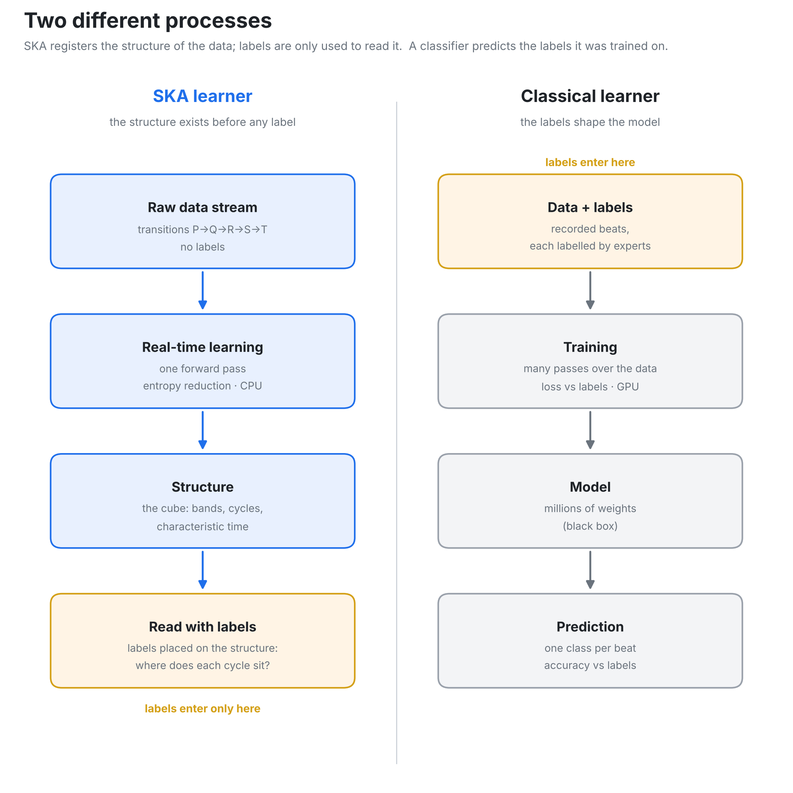

# How SKA differs from a classical AI

## Classical AI (right)

A classical AI learns from ECGs that cardiologists have already labelled: normal beat,
premature ventricular beat, atrial fibrillation, and so on.

It goes over thousands of labelled beats many times until it can repeat the labels on its own.
For a new ECG it then gives an answer, for example "this beat is a PVC".

You get the answer, but not the reason: the decision comes from millions of internal numbers
that nobody can read.

## SKA (left)

SKA receives the raw ECG, wave after wave: P, Q, R, S, T, then the next beat. It is given no
labels and no diagnosis.

It reads the recording once, in real time, and arranges what it reads into a 3D cube. The
structure of the heart appears in that cube:

- the five transitions of the beat (P→Q, Q→R, R→S, S→T, T→P) form five bands;
- a heart that repeats the same cycle stays in its bands;
- a cycle that differs leaves them.

Only then are the cardiologists' labels placed on the cube.

## Example: MIT-BIH record 119

In the cube of the time between cycles, the cycles form two bands:

- the short band holds the premature ventricular beats (V) and the normal cycles;
- the long band holds the normal beat that follows each V: the compensatory pause.

SKA was never told what a V or a compensatory pause is. It placed them apart on its own; the
labels only show what each band is.

## In one sentence

A classical AI repeats the labels it was taught. SKA shows the structure of the heart, and the
cardiologist reads that structure with their own labels.
